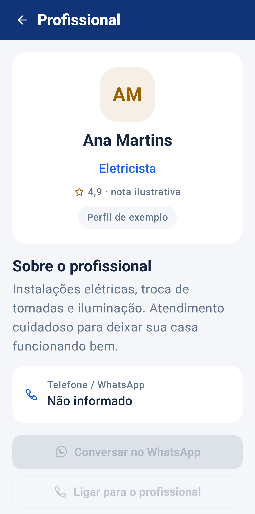
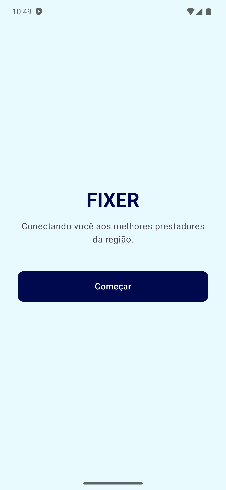
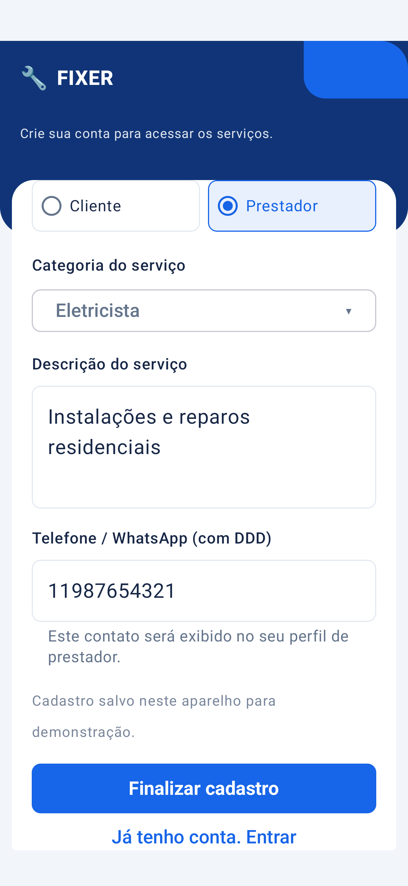

# FIXER

Aplicativo Android em Kotlin para conectar clientes a prestadores de serviços. A versão **1.1** completa o fluxo **Login → Catálogo → Detalhes → Contato**, usando Jetpack Compose, Material 3 e Navigation Compose.

## Integrantes

- Leonardo Bora Zimmermann.
- Victor Hugo de Miranda Assunção.
- Vitor Henrique de Melo.

## Funcionalidades

- Apresentação do aplicativo, cadastro como **Cliente** ou **Prestador** e confirmação do cadastro.
- Login local com senha oculta/revelada, opção **Lembrar de mim** e saída da conta.
- Cadastro de prestador com categoria, descrição e telefone/WhatsApp com DDD.
- Catálogo com cards de profissionais, avatar com iniciais e acesso aos detalhes.
- Pesquisa por nome ou categoria, ignorando acentos e diferenças entre maiúsculas e minúsculas.
- Filtros por categoria, combinação com pesquisa e mensagem quando nenhum profissional é encontrado.
- Detalhes com nome, categoria, descrição, avaliação ilustrativa quando aplicável e contato.
- Botão do WhatsApp que abre o link do contato e botão de ligação que abre o discador, sem realizar chamadas automaticamente.
- **Minha conta**, com os dados do usuário e atualização do telefone para prestadores.
- Prestadores cadastrados neste aparelho aparecem no catálogo. Clientes não são listados como profissionais.
- Persistência das contas após fechar o aplicativo e senhas protegidas com salt e PBKDF2.

## Telas e navegação

| Tela | Funcionamento |
| --- | --- |
| Apresentação | Apresenta o FIXER e direciona ao login. |
| Login | Autentica a conta local e abre o catálogo. A opção Lembrar de mim mantém a sessão em novas aberturas do app. |
| Cadastro | Valida nome, e-mail e senha; para prestadores, exige também categoria, descrição e telefone. |
| Confirmação | Mostra os dados registrados e permite ir para o login. |
| Catálogo | Pesquisa e filtra profissionais; abre o perfil selecionado. |
| Detalhes | Exibe as informações do profissional e os botões de contato. |
| Minha conta | Mostra os dados da conta, permite atualizar o contato do prestador e sair. |

O projeto utiliza uma `MainActivity`, com telas em Compose. Os nomes `LoginActivity`, `RegisterActivity`, `HomeActivity` e `DetailActivity` da proposta correspondem a essas telas; a lista usa `LazyColumn`, equivalente à finalidade de uma lista com `RecyclerView` nesta arquitetura.

## Demonstração local e dados de exemplo

**As contas e os prestadores cadastrados ficam somente neste aparelho.** Não há sincronização entre celulares. Desinstalar o aplicativo ou limpar seus dados apaga os cadastros locais.

O catálogo inclui cinco **perfis fictícios**, identificados pelo selo **Exemplo**. As notas desses perfis são ilustrativas e não representam avaliações de usuários. Esses exemplos não possuem telefone e seus botões de contato ficam desabilitados. Prestadores cadastrados localmente começam sem avaliações.

Para demonstrar o fluxo completo:

1. Cadastre um prestador com categoria, descrição e um telefone que você possa usar na apresentação.
2. Entre com essa conta, ou com uma conta de cliente criada no mesmo aparelho.
3. Pesquise o prestador e abra seu perfil.
4. Toque em WhatsApp para abrir a conversa ou em Ligar para abrir o discador.
5. Em Minha conta, o prestador pode corrigir ou adicionar seu telefone. Contas antigas continuam funcionando.

A abertura do WhatsApp pode utilizar o aplicativo instalado ou o navegador. Ligações dependem de um discador disponível; um emulador não realiza chamadas telefônicas reais.

## Ainda em desenvolvimento

- Autenticação e armazenamento online, com sincronização entre aparelhos.
- Recuperação de senha por e-mail.
- Avaliações enviadas por clientes e cálculo de médias reais.
- Fotos de perfil enviadas pelo usuário; nesta versão, os avatares usam iniciais.

As dependências do Firebase estão declaradas, mas a integração online não está implementada. Adicionar `google-services.json` não altera automaticamente o funcionamento local.

## APK

[**Baixar o APK atualizado do FIXER 1.1**](apk/FIXER.apk?raw=true)

Compatível com **Android 8.0 (API 26)** ou superior. Abra o arquivo no celular e permita a instalação pelo aplicativo usado para baixá-lo, caso o Android solicite. Instalar por cima da versão anterior, com a mesma assinatura, mantém os cadastros locais.

## Executar no Android Studio

1. Clone o repositório ou use **Code > Download ZIP** e extraia os arquivos.
2. Abra a pasta raiz que contém `settings.gradle.kts`, `gradlew` e a pasta `app`.
3. Configure o SDK Android **37** e o **JDK 25**; aguarde a sincronização.
4. Selecione um emulador ou celular compatível e execute o módulo **app**.

Ambiente usado: Android Studio 2026.1.3, Gradle 9.5.0 e Android Gradle Plugin 9.3.3. O Gradle Wrapper está incluído.

Para gerar o APK no PowerShell:

```powershell
.\gradlew.bat :app:assembleDebug
```

O resultado fica em `app/build/outputs/apk/debug/app-debug.apk`. No macOS/Linux, use `./gradlew :app:assembleDebug`.

## Telas

| Catálogo de profissionais | Detalhes do profissional |
| --- | --- |
|  |  |

| Início | Cadastro de prestador |
| --- | --- |
|  |  |

As capturas utilizam dados de teste para demonstrar as telas.

## Verificação

O projeto contém testes de pesquisa e telefone, cadastro e login, persistência, compatibilidade com cadastros antigos, atualização do contato, navegação do catálogo aos detalhes e geração dos intents de WhatsApp/discador.

```powershell
.\gradlew.bat :app:testDebugUnitTest :app:lintDebug
.\gradlew.bat :app:connectedDebugAndroidTest
```

O segundo comando requer um emulador ou celular conectado. Execute os testes em um emulador de apresentação: os testes de interface criam e removem contas de teste e exercitam a sessão local.

Verificação da entrega em **26/10/2026**: APK 1.1 compilado, **3 testes de lógica e 14 testes no emulador aprovados**, além da análise Lint sem erros. O emulador utilizado foi o Pixel 7 Pro com Android 13 (API 33).

## Arquivos para entrega

Este repositório inclui o código, o APK e as capturas de tela. Baixe o projeto completo em **Code > Download ZIP**. Consulte também [como executar o aplicativo](COMO_EXECUTAR.md).
